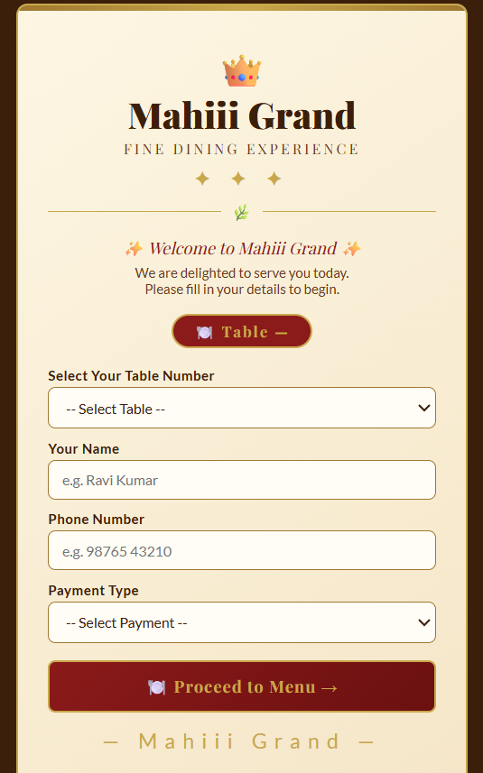
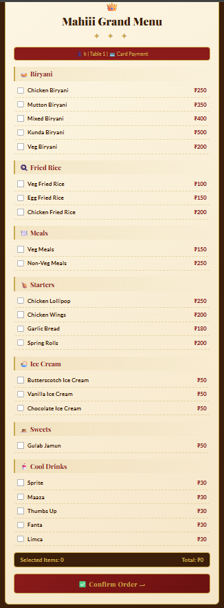
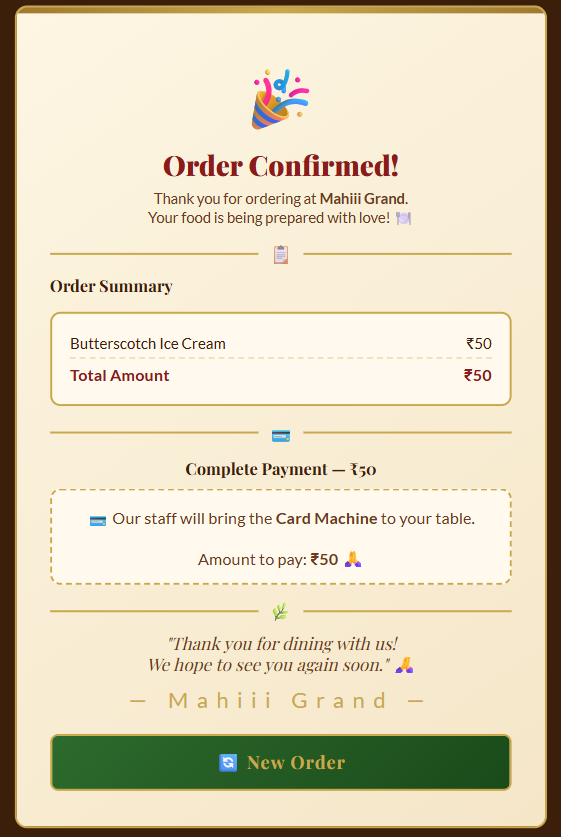

# Mahi Grand – Smart Restaurant Digital Menu

## 📌 Project Overview

Mahi Grand is a smart restaurant digital menu application designed to make the dining experience more convenient for customers. Customers can explore the menu, enter their details, select food items, and review their order total through a digital interface.

## ✨ Features

- Digital restaurant menu
- Customer details input
- Table number selection or entry
- Food item selection
- Automatic order total display
- Order confirmation and summary
- Payment method selection and instructions

## 🖥️ Project Screenshots

### 1. Welcome Page

### 2. Digital Menu

### 3. Order Status

## 🛠️ Technologies Used

- **Backend:** Python, Django
- **Frontend:** HTML, CSS
- **Database:** SQLite
- **Deployment:** Netlify (live frontend)

## 🌐 Live Demo

[Visit Mahi Grand Digital Menu](https://mahi-grand-digital-menu.netlify.app/)

## 🎯 Project Objective

The objective of this project is to provide a simple digital menu experience that helps customers browse food items and review their orders without relying entirely on a traditional printed menu.

## 🚀 Future Improvements

- Integrate secure online payment processing
- Improve mobile responsiveness and accessibility
- Add an order management interface for restaurant staff
- Enhance order tracking and database integration

## 👩‍💻 Developer

**Kavitha Vasamsetti**

Aspiring Data Analyst and technology enthusiast interested in building practical applications and solving real-world problems.
